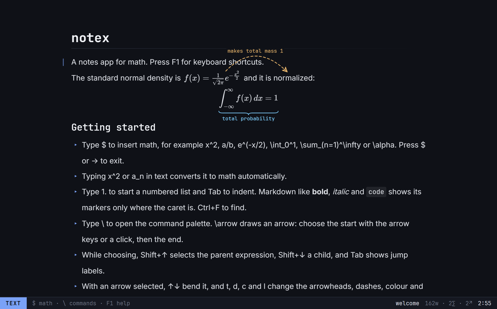

# notex

Math notes at lecture speed. Type prose and math in one flow, without reaching for the mouse,
and draw arrows and boxes *between parts of equations*.



**Try it in the browser:** https://cat-ione.github.io/notex/

## What it does

- **Math the way you say it.** `$` starts a formula. `a/b` is a fraction, `x^2` and `a_n` are
  scripts, `e^(-x^2/2)` groups, and `\name` gives any LaTeX symbol. Typing `x^2` or `a_n` in a
  sentence turns it into math by itself.
- **Draw on your notes.** Alt+drag from one word or symbol to another draws an arrow;
  Alt+Shift+drag draws a box, circle, underline or brace. Press `L` to write a note on it.
  Drawings stay attached to what they point at as you keep editing.
- **Markdown, like Obsidian.** `# ` headings, `- ` and `1. ` lists, `**bold**`, `*italic*`,
  `` `code` `` and code blocks, coloured by their language (Python, C++, Julia,
  R, MATLAB and more). The markers hide once the caret moves on.
- **Tables**, as in markdown (`| a | b |` with a `| --- |` line under the header), or `\table`.
  Cells work as in a word processor: Tab moves between them, Enter adds a row, selecting
  across cells selects whole cells, and a right-click in one adds or removes rows and columns
  and aligns them. Formulas and drawings work inside them; files keep them as markdown.
- **Images.** Paste or drop them in; they're kept inside the note.
- **Yours to change.** Themes, text size, fonts, snippets, which substitutions happen as you
  type, and your own CSS (Ctrl+,).
- **PDF and LaTeX.** `\pdf` saves the note as a PDF, drawings and all (Ctrl+P prints it);
  `\export` copies it as LaTeX, drawings included (tikz).

Press **F1** in the app for every shortcut.

## Keys worth knowing

| | |
|---|---|
| `$` / `$$` | inline / display math |
| `\` or Ctrl+K | command palette |
| `/` `^` `_` | fraction, superscript, subscript |
| space / Tab | leave a box / next box |
| `$`, → or Esc | back to text |
| Alt+drag, Alt+Shift+drag | arrow, shape |
| Ctrl+D | draw menu |
| Ctrl+B / Ctrl+I | bold / italic |
| Tab / Shift+Tab | indent / outdent a list item |
| Ctrl+F | find |
| Ctrl+S / Ctrl+O / Ctrl+N | save / open / new |
| `\pdf` / Ctrl+P | save as PDF / print |

## Files

In the browser, every note is kept there as you type: Ctrl+O lists them (type to filter, F2
renames, Shift+Del deletes) and Ctrl+N starts a new one. Ctrl+S also saves the note to a
`.ntx` file and keeps saving to it (in Chrome and Edge; other browsers download it). Once
opened, the site works offline and can be installed as an app.

Notes are `.ntx` files: compact JSON (see `src/lib/format.ts`).

## Customizing

The toolbar along the top has notes, saving, math, drawing, images, find and PDF, each
showing its keys when hovered; it fades while you type. It and the status bar can be hidden
(settings, `\toolbar`, `\statusbar`), and everything stays on its keys.

Ctrl+, opens settings and an editor for the config file. On desktop the file is `config.json`
in the app's config directory; you can also open it in your own editor, and changes load when
you switch back to notex.

```jsonc
{
  "theme": "ember",                       // built-in: midnight, phosphor, paper
  "fontSize": 16,
  "pageWidth": 820,
  "fonts": { "prose": "", "mono": "" },   // any CSS font-family
  "typing": { "pairBrackets": true, "autoMath": true },
  "snippets": {
    "math": {                             // expand while typing in math; # = caret
      "norm": "\\left\\| # \\right\\|",
      "pd": "\\frac{\\partial #}{\\partial }"
    },
    "text": { "->": "→" }                 // text may contain $math$
  },
  "themes": {                             // CSS variable overrides on a base theme
    "ember": { "base": "midnight", "colors": { "accent": "#ff9e64" } }
  },
  "css": ".block.h1 { letter-spacing: 0.02em; }"
}
```

## Development

Svelte 5 + SvelteKit (SPA) + Tauri 2, KaTeX for rendering, pnpm.

```sh
pnpm install
pnpm tauri dev     # desktop app
pnpm dev           # browser only, http://localhost:1420
pnpm check         # type-check
pnpm test          # unit tests
pnpm test:e2e      # browser tests (builds the site; CHROME=<path> to use your own Chrome)
pnpm tauri build   # desktop installer for this system
```

With `pnpm dev` running (or a production build served with `?lab` in the URL):

```sh
node tools/perf/perf.mjs [--profile[=action]] [--file=note.ntx]   # editing speed on large notes
node tools/label-lab/lab.mjs <name>             # note layout scenarios + typing check
```

Both use `playwright-core`; set `CHROME` to a Chrome/Chromium executable if it can't find one.

**Branches.** Work happens on `dev`, where every push runs the unit and browser tests and the type-check. Merge
into `main` once it works: `main` is what the site and releases are built from.

**Releasing.** Every push to `main` rebuilds the browser version on GitHub Pages. There are no
desktop releases yet; when there are, pushing a tag like `v0.1.0` builds the installers for all
three systems into a draft release to publish from the Releases page (bump the version in
`package.json`, `src-tauri/tauri.conf.json` and `src-tauri/Cargo.toml` first).

### How it works

- **Document model** (`src/lib/model.ts`): blocks of items; an item is a character or a
  math item. Math is a tree of `sym`s and slot-bearing `cmd`s (frac, sqrt, scripts,
  delimiters, matrices…). Every node has a stable id.
- **Rendering** (`src/lib/math/latex.ts`): the tree is turned into LaTeX where each node is
  wrapped in `\htmlData{nx=<id>}`. KaTeX treats these as transparent for spacing, so the
  output looks normal but every glyph maps back to a node. That mapping drives the caret,
  jump labels and arrow endpoints.
- **Arrows and shapes** anchor to *ids*, not to positions, so they follow their endpoints as you edit.
  Geometry is recomputed from the DOM after each render (`src/lib/arrows.ts`).
- **Editor** (`src/lib/editor.svelte.ts`): ordinary text editing by default; focused modes only
  for math, choosing arrow endpoints and styling drawings.

## License

MIT
